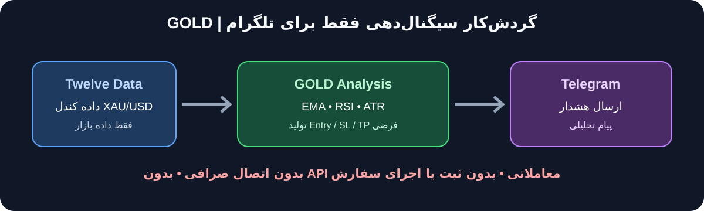

# GOLD / XAUUSD Telegram Signal Notifier

وضعیت مراحل تکمیل، نتایج CI، ترتیب PRها و موارد باقی‌مانده برای تأیید نهایی در فایل [RELEASE_CHECKLIST.md](RELEASE_CHECKLIST.md) ثبت می‌شود.

این ابزار مستقل برای ارسال هشدارهای تحلیلی طلا به تلگرام است. فقط نماد **XAU/USD** را از Twelve Data می‌خواند و **هیچ اتصال صرافی/کارگزاری، API معاملاتی، ثبت سفارش یا اجرای معامله‌ای ندارد**. تست معماری نیز به‌صورت خودکار نبود SDKهای صرافی، توابع رایج ثبت سفارش و درخواست HTTP POST خارج از فرستنده تلگرام را کنترل می‌کند.

## نمای کلی گردش‌کار

**سلب مسئولیت:** خروجی‌ها صرفاً اطلاع‌رسانی‌اند و مشاوره مالی یا تضمین سود نیستند. ریسک‌ها و محدودیت‌ها در [سلب مسئولیت کامل](tools/gold_signal_bot/DISCLAIMER_FA.md) آمده است.

## منطق نسخه اولیه
- داده: کندل XAU/USD از Twelve Data؛ فقط کندل‌های کاملاً بسته‌شده.
- روند: EMA 20 و EMA 50.
- تأیید مومنتوم: RSI 14.
- ماشه: عبور قیمت بسته‌شدن از EMA20 در جهت روند، همراه با فیلتر RSI.
- حد ضرر: 1.5 برابر ATR(14) به‌صورت پیش‌فرض.
- TP1: برابر 1R و TP2: برابر 2R.
- ضدتکرار: زمان کندل پس از ارسال موفق ذخیره می‌شود.
- چرخه عمر سیگنال پس از کندل تأییدشده پایش می‌شود: TP1، TP2، SL و انقضای زمانی؛ پیام‌ها فقط وضعیت فرضی سیگنال را گزارش می‌کنند.
- اگر TP1 و TP2 در یک کندل لمس شوند، اعلان‌ها به‌ترتیب TP1 سپس TP2 ارسال می‌شوند؛ اگر SL و هدف در یک کندل لمس شوند، قاعده محافظه‌کارانه SL-first اعمال می‌شود.
- اعتبار پیش‌فرض سیگنال یک روز متناسب با تایم‌فریم است؛ مثلاً 15min=96، 1h=24 و 4h=6 کندل بسته‌شده.
- اگر داده کافی/معتبر نباشد، سیگنال ساخته نمی‌شود.
- کنترل OHLC، کندل‌های بسته، زمان آینده، تکرارهای متناقض، تازگی داده و شکاف‌های داخلی تاریخچه انجام می‌شود.
- خطاهای موقت شبکه و پاسخ‌های 408/425/5xx طبق تنظیمات retry و backoff محدود دوباره امتحان می‌شوند. HTTP 429 مسیر جداگانه دارد: برنامه سهمیه را از Twelve Data بررسی می‌کند و در حالت polling تا پایان پنجره دقیقه‌ای یا روزانه مکث می‌کند؛ 429 را نباید با retry عادی یکی دانست.
- روزی یک‌بار مصرف API بررسی می‌شود و در صورت رسیدن مصرف روزانه به ۸۰٪ یا بیشتر، هشدار تلگرام ارسال می‌شود.
- قفل بین‌پردازه‌ای مانع اجرای هم‌زمان چند نمونه و رقابت روی فایل وضعیت می‌شود.
- دو فایل مستقل وجود دارد: cursor پردازش کندل‌ها و outbox/WAL ثبت وضعیت تحویل پیام. رکوردهای `PENDING` و `SENDING` پیش از ارسال اتمیک ذخیره می‌شوند؛ `SENT` فقط پس از پاسخ معتبر تلگرام و `message_id` ثبت می‌شود. cursor برای کندل‌های بدون سیگنال نیز جلو می‌رود و پس از ثبت پایدار `SENT` برای سیگنال جلو می‌رود.
- اگر برنامه پس از شروع ارسال متوقف شود و نتیجه ارسال مبهم بماند، وضعیت `UNKNOWN` می‌شود و بازیابی با برچسب `[RECOVERY RETRY]` انجام می‌شود. به‌دلیل محدودیت ذاتی ابهام شبکه، تحویل exactly-once تضمین نمی‌شود و در این حالت احتمال پیام تکراری وجود دارد.

این فقط یک استراتژی نمونه قابل‌آزمایش است، نه تضمین دقت یا سودآوری. پیش از استفاده واقعی، بک‌تست، آزمون خارج از نمونه و forward-test لازم است. قیمت XAU/USD ارائه‌دهنده ممکن است با قیمت کارگزار و اسپرد آن متفاوت باشد.

## سخت‌افزار موردنیاز
GOLD سبک است و برای اجرای پایه به GPU یا کارت گرافیک مجزا نیاز ندارد. حداقل برآورد برای خود ربات حدود ۲ هستهٔ منطقی ۶۴ بیتی، ۲GB RAM آزاد و ۱GB فضای خالی است؛ پیشنهاد راحت‌تر ۲ هسته یا بیشتر، ۴GB RAM آزاد و SSD با حداقل ۵GB فضای خالی است. برای Windows 11، داشتن ۸GB RAM کل سیستم توصیه می‌شود. این اعداد بنچمارک تضمینی نیستند؛ راهنمای [سخت‌افزار و سیستم‌عامل‌ها](tools/gold_signal_bot/PLATFORM_SUPPORT_FA.md) و آزمون پایداری ۲۴ تا ۷۲ ساعته را ببین.

## راهنمای نصب از صفر

راهنمای کامل نصب Windows 11، نسخه‌های Python پشتیبانی‌شده، ساخت API Key، ساخت ربات تلگرام، تنظیم `.env`، اجرای تست‌ها، راه‌اندازی و عیب‌یابی در [راهنمای نصب Windows](tools/gold_signal_bot/INSTALL_WINDOWS_FA.md) آمده است.

## پیش‌نیازها
- Windows 11
- Python 3.11، 3.12، 3.13 یا 3.14؛ هر چهار نسخه در CI روی Ubuntu و Windows آزموده می‌شوند. Python 3.11 انتخاب محافظه‌کارانه مناسبی برای اولین اجرای محلی است.
- کلید API از Twelve Data برای XAU/USD
- ربات تلگرام و Chat ID مقصد
- اینترنت پایدار

این نسخه عمداً به Yahoo Finance و نماد آتی GC=F برنمی‌گردد؛ اگر داده spot از Twelve Data در دسترس نباشد، خطا می‌دهد تا قیمت آتی به‌جای XAU/USD ارسال نشود.

## نصب در Windows 11 / PowerShell
از ریشه مخزن اجرا کن:

    py -3.11 -m venv .venv-gold
    .\.venv-gold\Scripts\Activate.ps1
    python -m pip install --upgrade pip
    pip install -r tools\gold_signal_bot\requirements.txt

اگر PowerShell فعال‌سازی را مسدود کرد:

    Set-ExecutionPolicy -Scope Process -ExecutionPolicy Bypass
    .\.venv-gold\Scripts\Activate.ps1

## تنظیمات محرمانه
ابتدا از ریشه مخزن فایل نمونه را کپی کن و سپس فایل محلی `.env` را ویرایش کن. فایل `.env` در مخزن وجود ندارد و در Git نادیده گرفته می‌شود؛ کلیدها را در GitHub یا تلگرام منتشر نکن.

    Copy-Item .env.example .env

    GOLD_TWELVE_DATA_API_KEY=کلید_Twelve_Data
    GOLD_TELEGRAM_BOT_TOKEN=توکن_ربات_تلگرام
    GOLD_TELEGRAM_CHAT_ID=آیدی_چت_یا_کانال
    GOLD_TIMEFRAME=15min
    GOLD_POLL_SECONDS=45
    GOLD_RISK_ATR_MULTIPLIER=1.5
    GOLD_TP1_R=1.0
    GOLD_TP2_R=2.0

ربات را به کانال اضافه کن و اجازه ارسال پیام بده. برای گروه/کانال خصوصی، Chat ID صحیح لازم است.

## ساختار ماژولار و پوشش تست آفلاین

کد ربات به ماژول‌های مستقل تنظیمات، داده بازار، اندیکاتورها، منطق استراتژی، تلگرام، وضعیت پایدار، سرویس اجرای یک چرخه و رابط خط فرمان تقسیم شده است. فایل `gold_signal_bot.py` برای سازگاری با فرمان و import قبلی به‌عنوان facade حفظ شده است. جزئیات مرزبندی در [`tools/gold_signal_bot/ARCHITECTURE.md`](tools/gold_signal_bot/ARCHITECTURE.md) آمده است.

مجموعه تست آفلاین بدون کلید واقعی، اتصال زنده به سرویس‌ها، صرافی/کارگزاری یا ارسال پیام واقعی اجرا می‌شود. پوشش شامل تنظیمات، داده‌های OHLC، retry و rate limit، خطاهای موقت شبکه و HTTP 429، بستن response/sessionها، محاسبات EMA/RSI/ATR، منطق BUY/SELL، محاسبه SL/TP، قالب و ارسال تلگرام، ذخیره وضعیت، قفل بین‌پردازه‌ای، جلوگیری از ارسال تکراری و قراردادهای معماری است. تعداد تست‌ها معیار کیفیت نیست؛ CI همه تست‌های کشف‌شده را اجرا می‌کند و تست‌های ضعیف باید بازنگری شوند. ماتریس فعلی CI Python 3.11 تا 3.14 را روی Windows و Ubuntu پوشش می‌دهد.

برای کنترل کیفیت تست‌های حیاتی، اسکریپت `mutation_audit.py` چند خطای عمدی را فقط در کپی موقت پروژه تزریق می‌کند و بررسی می‌کند تست هدف واقعاً fail شود. گزارش دامنه و محدودیت‌ها در [`tools/gold_signal_bot/TEST_QUALITY_AUDIT.md`](tools/gold_signal_bot/TEST_QUALITY_AUDIT.md) ثبت شده است. این آزمون جهش محدود است و به‌معنای پوشش جهش تمام شاخه‌های برنامه نیست.

وجود تست به‌معنای اثبات سودآوری یا دقت آینده سیگنال نیست. پس از دریافت نسخه جدید، کل مجموعه تست را روی Windows اجرا و نتیجه را بررسی کن؛ تا آن زمان وضعیت اجرای محلی «در انتظار تأیید» است.

## تست و اجرا
از ریشه مخزن:

    python tools\gold_signal_bot\gold_signal_bot.py --test-telegram
    python tools\gold_signal_bot\gold_signal_bot.py --once
    python tools\gold_signal_bot\gold_signal_bot.py

- دستور اول فقط اتصال تلگرام را آزمایش می‌کند.
- دستور دوم یک بار داده را می‌خواند و در صورت وجود سیگنال تأییدشده ارسال می‌کند.
- دستور سوم پایش پیوسته را اجرا می‌کند.
- برای توقف، Ctrl+C بزن.

## متغیرهای اختیاری
| متغیر | پیش‌فرض | توضیح |
|---|---:|---|
| GOLD_TIMEFRAME | 15min | یکی از 1min, 5min, 15min, 30min, 1h, 4h, 1day |
| GOLD_POLL_SECONDS | 45 در `.env.example`؛ اگر unset باشد، `max(20, min(60, timeframe_seconds // 10))` | فاصله بررسی؛ حداقل 10 ثانیه |
| GOLD_RISK_ATR_MULTIPLIER | 1.5 | ضریب ATR برای فاصله SL |
| GOLD_TP1_R | 1.0 | فاصله TP1 بر حسب R |
| GOLD_TP2_R | 2.0 | فاصله TP2 بر حسب R و باید از TP1 بیشتر باشد |
| SIGNAL_TTL_CANDLES | متناسب با تایم‌فریم | تعداد کندل‌های بسته‌شده اعتبار سیگنال؛ مقدار خالی یعنی پیش‌فرض یک‌روزه |
| GOLD_SIGNAL_STATE_FILE | فایل در پوشه home کاربر | محل ذخیره ضدتکرار |
| GOLD_HTTP_TIMEOUT | 20 | مهلت درخواست HTTP بر حسب ثانیه |
| GOLD_RETRY_ATTEMPTS | 3 | تعداد تلاش دریافت داده (۱ تا ۸) |
| GOLD_RETRY_BASE_SECONDS | 1 | تأخیر پایه retry با افزایش نمایی |
| GOLD_STALE_CANDLE_MULTIPLIER | 3 | حداکثر سن داده بر حسب ضریب طول تایم‌فریم |
| GOLD_MAX_GAP_MULTIPLIER | 1.5 | آستانه تشخیص شکاف داخلی بر حسب ضریب تایم‌فریم |
| GOLD_LOG_LEVEL | INFO | سطح ثبت گزارش؛ با `logging` پایتون تنظیم می‌شود |

## رفتار شروع و بازیابی پردازش

- در اولین اجرا، چون cursor وجود ندارد، فقط آخرین کندل بسته‌شده ارزیابی می‌شود؛ کندل‌های قدیمی‌تر عمداً backfill نمی‌شوند.
- در اجراهای بعدی، کندل‌های پردازش‌نشده به‌ترتیب زمانی catch-up می‌شوند. برای محاسبه پایدار اندیکاتورها، ۲۰۰ کندل warm-up لازم است.
- اگر cursor قدیمی‌تر از اولین کندل موجود در تاریخچه ارائه‌دهنده باشد، برنامه fail-closed می‌کند و از رد شدن خاموش سیگنال‌های احتمالی جلوگیری می‌کند.
- دریافت تاریخچه بازار حداکثر تا ۵۰۰۰ کندل محدود است؛ بنابراین بازیابی نامحدود یا backfill کامل تاریخچه تضمین‌شده نیست.

تست قرارداد signal-only در `tools/gold_signal_bot/tests/test_signal_only_contract.py` الگوهای شناخته‌شده‌ای مانند import کتابخانه‌های صرافی، توابع رایج سفارش‌گذاری، hostهای صرافی و درخواست POST خارج از فرستنده تلگرام را در فایل‌های runtime بررسی می‌کند. این کنترل ایستا و مبتنی بر الگو است؛ به‌تنهایی اثبات ریاضی نبود هر مسیر پویا یا ناشناخته‌ای نیست.

## کنترل‌های پایداری و محدودیت‌ها
- شکاف‌های معمول بین کندل‌ها بررسی می‌شوند. توقف روزانه/آخرهفته طلا با چند استثنای UTC محافظه‌کارانه لحاظ شده است؛ ساعات واقعی ارائه‌دهنده ممکن است با DST یا سیاست داده تغییر کند. اگر داده معتبر به‌علت این تفاوت رد شد، ابتدا زمان‌بندی نماد XAU/USD در Twelve Data را بررسی و سپس آستانه‌ها را متناسب تنظیم کن؛ آستانه‌ها را بی‌دلیل بالا نبر.
- بررسی تازگی و شکاف، جایگزین تأیید رسمی ساعات معاملاتی ارائه‌دهنده نیست. این ربات فقط داده‌ای را اعتبارسنجی می‌کند که Twelve Data برمی‌گرداند.
- درخواست دریافت کندل‌ها retry می‌شود؛ پیام تلگرام عمداً blind-retry نمی‌شود، چون ممکن است تلگرام پیام را دریافت کرده باشد ولی پاسخ شبکه گم شده باشد و retry باعث پیام تکراری شود.
- فایل قفل کنار فایل وضعیت ساخته می‌شود و قفل سیستم‌عامل هنگام خروج آزاد می‌شود. اگر پردازش به‌صورت غیرعادی خاتمه یابد، قفل OS آزاد می‌شود؛ خود فایل .lock می‌تواند باقی بماند و طبیعی است.

## بک‌تست واقعی از طریق GitHub Actions (بدون نیاز به داشتن پروژه روی سیستم)

پس از ادغام نسخه تأییدشده در شاخه پیش‌فرض، می‌توان بک‌تست دو‌ساله و آزمون تطبیق مسیر زنده/تاریخی را از خود GitHub اجرا کرد:

1. در مخزن، از مسیر Settings → Secrets and variables → Actions یک Repository secret با نام `GOLD_TWELVE_DATA_API_KEY` بساز و کلید Twelve Data را فقط همان‌جا وارد کن.
2. به تب Actions برو و workflow با نام **GOLD real-data backtest and parity (manual)** را انتخاب کن.
3. تاریخ شروع/پایان، تایم‌فریم و هزینه تخمینی هر سمت را انتخاب و Run workflow را اجرا کن.
4. پس از موفقیت، artifact با گزارش JSON/CSV بک‌تست و fixture پاک‌سازی‌شده تطبیق را دریافت کن.

این workflow فقط روی Windows runner و با اجرای دستی کار می‌کند. کد درخواست خطاهای HTTP و شبکه را بدون چاپ URL درخواست گزارش می‌کند؛ بااین‌حال هیچ workflow یا سیستم log را نباید تضمین مطلقِ عدم افشای secret تلقی کرد. کلید را در log یا artifact قرار نده و خروجی‌ها را پیش از اشتراک‌گذاری بازبینی کن. برای آن به توکن تلگرام نیاز نیست. اگر Secret تنظیم نشده باشد، اجرا در مرحله اول متوقف می‌شود. خروجی بک‌تست، نتیجه تاریخی است و تضمین سود یا کیفیت اجرای آینده نیست.

## آزمون واقعی ارسال تلگرام از طریق GitHub Actions

پس از ادغام نسخه تأییدشده در شاخه پیش‌فرض، برای آزمایش یک پیام واقعی تلگرام:
1. در Settings → Secrets and variables → Actions دو Repository secret با نام‌های `GOLD_TELEGRAM_BOT_TOKEN` و `GOLD_TELEGRAM_CHAT_ID` بساز.
2. در تب Actions، workflow با نام **GOLD Telegram connectivity test (manual)** را انتخاب و Run workflow را بزن.
3. workflow فقط یک پیام آزمایشی ارسال می‌کند و نتیجه موفق/ناموفق را در Actions نشان می‌دهد؛ هیچ سیگنال یا سفارشی اجرا نمی‌کند.

برای اجرای ربات روی Windows 11، همین مقادیر را فقط در فایل محلی `.env` تنظیم کن. هیچ توکن یا Chat ID را در چت، کد، log یا commit قرار نده.

## آزمون پایداری Windows 11

پس از تأیید نسخه و آماده‌سازی فایل `.env`، ربات را روی Windows 11 اجرا کن و در پنجره دوم اسکریپت پایش ۲۴، ۴۸ یا ۷۲ ساعته را اجرا کن. این اسکریپت مصرف حافظه، زنده‌بودن پردازش، اندازه و سلامت JSON فایل وضعیت/WAL و تعداد پیام‌های در انتظار را در CSV ثبت می‌کند. روش کامل در `tools/gold_signal_bot/STABILITY_TEST.md` آمده است. این آزمون باید روی سیستم واقعی اجرا شود و CI ابری جایگزین آن نیست.

## چک‌لیست پیش از استفاده
1. ابتدا تست تلگرام را اجرا و دریافت پیام را دستی تأیید کن.
2. با --once مطمئن شو API داده کافی و کندل‌های بسته‌شده می‌دهد.
3. تا قبل از ارزیابی بک‌تست و forward-test، سیگنال‌ها را فقط روی کاغذ ثبت کن.
4. Entry/SL/TP بر اساس قیمت بسته‌شدن کندل‌اند؛ قیمت اجرا، اسپرد، لغزش و کمیسیون کارگزار را لحاظ نمی‌کنند.
5. اگر API key یا مجوز نماد/تایم‌فریم کافی نباشد، ابزار سیگنال تولید نمی‌کند و خطا می‌دهد.
6. برنامه را روی ویندوز روشن و متصل به اینترنت نگه دار؛ برای اجرای دائمی، بعداً به سرویس/سرور منتقلش کن.

هیچ بخشی از این ابزار نباید به API سفارش‌گذاری یا کلید معاملاتی متصل شود.
