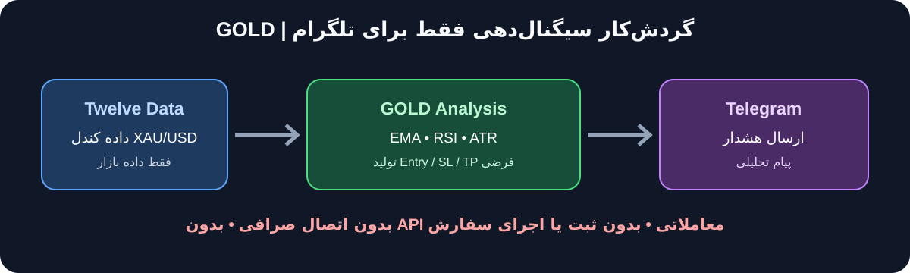

# راهنمای سیستم‌عامل‌ها و ماتریس پشتیبانی GOLD



> **سلب مسئولیت:** این ابزار فقط هشدار تحلیلی می‌فرستد؛ مشاوره مالی، تضمین سود یا اجرای معامله ارائه نمی‌کند. [جزئیات ریسک و محدودیت‌ها](DISCLAIMER_FA.md).

این سند تفاوت «آزموده‌شده در CI»، «راهنمای نصب موجود» و «هنوز تأییدنشده روی دستگاه واقعی» را روشن می‌کند. اجرای موفق CI به‌تنهایی جایگزین تست روی سیستم مقصد، API واقعی Twelve Data، تلگرام یا آزمون پایداری نیست.

## خلاصه وضعیت

| سیستم‌عامل | وضعیت شواهد فعلی | توصیه |
|---|---|---|
| Windows 11 | راهنمای نصب PowerShell موجود است؛ CI روی runner با برچسب `windows-latest` اجرا می‌شود، اما این runner لزوماً Windows 11 نیست و تست روی رایانهٔ کاربر محسوب نمی‌شود. | گزینهٔ اصلی برای نصب محلی طبق راهنمای Windows 11؛ تست واقعی 24 تا 72 ساعت لازم است. |
| Windows 10 | در این مخزن تست اختصاصی روی Windows 10 ثبت نشده است. `windows-latest` را نباید معادل Windows 10 دانست. | وضعیت «تأییدنشده»؛ تا اجرای تست دستی کامل روی Windows 10، پشتیبانی تضمین‌شده اعلام نمی‌شود. |
| Ubuntu Linux | CI روی runner با برچسب `ubuntu-latest` اجرا می‌شود. این تأیید برای runner میزبانی‌شده است، نه همه نسخه‌های Ubuntu یا هر سرور لینوکسی. | مناسب‌ترین مسیر مستندشده برای سرور Linux؛ نسخه و محیط واقعی سرور باید جداگانه آزموده شود. |
| macOS | در ماتریس CI فعلی نیست و نصب روی macOS در این مخزن به‌صورت عملی تأیید نشده است. | احتمال سازگاری به‌دلیل Python و وابستگی‌های عمومی وجود دارد، اما فعلاً «آزموده‌نشده» است. |

## نسخه‌های Python

- Python **3.11، 3.12، 3.13 و 3.14** در ماتریس فعلی CI روی runnerهای `windows-latest` و `ubuntu-latest` آزموده می‌شوند.
- برای اولین نصب Windows، Python 3.11.x انتخاب محافظه‌کارانهٔ راهنمای Windows است.
- برای Ubuntu نیز یکی از نسخه‌های 3.11 تا 3.14 را انتخاب کن؛ نسخهٔ 3.11 برای شروع انتخاب ساده‌ای است.
- این ماتریس به‌معنای آزمون همهٔ نسخه‌های جزئی/توزیع‌های Python، همهٔ نسخه‌های Windows/Ubuntu یا macOS نیست.
- نسخه‌های قدیمی‌تر از 3.11 و نسخه‌های جدیدتر خارج از ماتریس، در حال حاضر تأییدشده نیستند.

## Windows 11

راهنمای کامل گام‌به‌گام PowerShell، نصب Git و Python، ساخت محیط مجازی، فایل محرمانه `.env`، Twelve Data، ربات تلگرام، تست و عیب‌یابی در [INSTALL_WINDOWS_FA.md](INSTALL_WINDOWS_FA.md) قرار دارد.

## Windows 10

در حال حاضر راهنمای اختصاصی و نتیجهٔ تست واقعی Windows 10 در مخزن ثبت نشده است. موفقیت job با برچسب `windows-latest` اثبات نمی‌کند که برنامه روی Windows 10 آزموده شده؛ برچسب runner ممکن است به نسخهٔ دیگری از Windows اشاره کند.

اگر قصد آزمایش روی Windows 10 را داری:
1. سیستم‌عامل و به‌روزرسانی‌های آن را ثبت کن.
2. Python 3.11 تا 3.14، Git for Windows و PowerShell در دسترس را نصب کن.
3. از دستورهای محیط مجازی و requirements در راهنمای Windows استفاده کن؛ مسیرها و فرمان‌های PowerShell ممکن است با توجه به نصب متفاوت باشند.
4. تست‌های آفلاین و mutation audit را اجرا کن.
5. ارسال آزمایشی تلگرام، اجرای `--once` و سپس آزمون پایداری را انجام بده.
6. تا ثبت نتیجهٔ موفق این مراحل، Windows 10 را «تأییدشده» در نظر نگیر.

## Ubuntu و سرور Linux

نمونهٔ زیر برای Ubuntu با Python 3.11 و Bash است. روی سرور ابتدا نسخهٔ Ubuntu و دسترسی Python را بررسی کن. نام بسته‌ها ممکن است با نسخهٔ توزیع تفاوت داشته باشد.

### نصب ابزارها و دریافت پروژه

```bash
sudo apt update
sudo apt install -y git python3.11 python3.11-venv python3-pip
git clone https://github.com/Mohammad8917/GOLD.git
cd GOLD
git switch main
git pull
```

اگر مخزن یا سیستم‌عامل تو بستهٔ `python3.11` را در مخزن رسمی ندارد، از روش رسمی همان توزیع برای نصب یکی از Pythonهای 3.11 تا 3.14 استفاده کن؛ از نصب اسکریپت‌های ناشناس خودداری کن.

### محیط مجازی و وابستگی‌ها

```bash
python3.11 -m venv .venv-gold
source .venv-gold/bin/activate
python -m pip install --upgrade pip
python -m pip install -r tools/gold_signal_bot/requirements.txt
```

### تنظیم فایل محرمانه

فایل نمونه در ریشهٔ مخزن است:

```bash
cp .env.example .env
chmod 600 .env
nano .env
```

سه مقدار ضروری را فقط روی سرور تنظیم کن: `GOLD_TWELVE_DATA_API_KEY`، `GOLD_TELEGRAM_BOT_TOKEN` و `GOLD_TELEGRAM_CHAT_ID`. سایر گزینه‌ها در صورت نیاز از مقادیر نمونه استفاده می‌کنند. فایل واقعی `.env` را commit یا در پیام/گزارش عمومی منتشر نکن.

بررسی کن فایل ignore شده باشد:

```bash
git check-ignore .env
git status --short
```

### تست و اجرا

```bash
python -m unittest discover -s tools/gold_signal_bot -p 'test_*.py' -v
python tools/gold_signal_bot/mutation_audit.py
python tools/gold_signal_bot/gold_signal_bot.py --test-telegram
python tools/gold_signal_bot/gold_signal_bot.py --once
python -u tools/gold_signal_bot/gold_signal_bot.py
```

اجرای پیوسته را ابتدا در نشست کنترل‌شده انجام بده. برای سرویس دائمی Linux، پیش از ساخت systemd unit یا زمان‌بندی خودکار، اجرای دستی و آزمون پایداری را تکمیل کن. هم‌زمان بیش از یک نمونه را با فایل state مشترک اجرا نکن. از قراردادن توکن‌ها در command line، unit file عمومی، log یا repository خودداری کن؛ در استقرار سرویس از روش امن نگهداری secret متناسب با سرور استفاده کن.

## macOS

macOS در ماتریس فعلی CI نیست؛ بنابراین این دستورها فقط مسیر آزمایشی پیشنهادی‌اند و تأیید رسمی سازگاری محسوب نمی‌شوند. از Python رسمی یا روش مدیریتی مورد اعتماد خودت و Git استفاده کن.

```bash
git clone https://github.com/Mohammad8917/GOLD.git
cd GOLD
python3.11 -m venv .venv-gold
source .venv-gold/bin/activate
python -m pip install --upgrade pip
python -m pip install -r tools/gold_signal_bot/requirements.txt
cp .env.example .env
chmod 600 .env
```

مقادیر محرمانه را در `.env` تنظیم کن، سپس همان تست‌های آفلاین، تست تلگرام، `--once` و آزمون پایداری را اجرا کن. تا وقتی macOS به ماتریس CI اضافه و روی نسخهٔ واقعی سیستم آزموده نشده، آن را پلتفرم تأییدشده اعلام نمی‌کنیم.

## نیاز سخت‌افزاری برای اجرای پایدار

GOLD یک برنامهٔ سبک Python است: دادهٔ کندل را از طریق HTTPS دریافت می‌کند، اندیکاتورها را محاسبه می‌کند و پیام را به تلگرام می‌فرستد. برای این کار **GPU یا کارت گرافیک مجزا لازم نیست**. بااین‌حال، مقادیر زیر برآورد عملی برای شروع‌اند، نه نتیجهٔ بنچمارک رسمی؛ مصرف واقعی به سیستم‌عامل، تایم‌فریم، logها و مدت اجرا بستگی دارد.

### حداقل پیشنهادی برای خود ربات

| قطعه | حداقل برای اجرای آزمایشی | پیشنهاد برای اجرای راحت‌تر و پایدارتر |
|---|---|---|
| پردازنده | ۲ هستهٔ منطقی ۶۴ بیتی | ۲ هستهٔ واقعی یا بیشتر، x86-64 |
| RAM | ۲ گیگابایت فضای آزاد برای برنامه؛ سیستم‌عامل جداگانه RAM می‌خواهد | ۴ گیگابایت RAM آزاد برای ربات و سرویس‌های همراه |
| فضای ذخیره‌سازی | حدود ۱ گیگابایت فضای خالی | SSD با حداقل ۵ گیگابایت فضای خالی برای محیط مجازی، log و فایل‌های state |
| شبکه | اینترنت پایدار با امکان اتصال HTTPS به Twelve Data و Telegram | اتصال سیمی یا Wi-Fi پایدار؛ بدون قطعی مکرر و با امکان اتصال خروجی روی پورت 443 |
| گرافیک | گرافیک مجتمع معمولی کافی است | GPU مجزا لازم نیست |
| برق/دسترس‌پذیری | دستگاه هنگام اجرا روشن بماند | برق پایدار و در صورت امکان UPS برای PC یا سرور محلی |

**توجه به RAM کل دستگاه:** اعداد RAM آزاد بالا مربوط به فضای قابل‌استفاده برای ربات است، نه الزام کل Windows. برای رایانهٔ Windows 11 که هم‌زمان کارهای معمول دیگری انجام می‌دهد، ۸ گیگابایت RAM کل سیستم انتخاب مناسب‌تری است؛ ۴ گیگابایت کل سیستم ممکن است برای خود Windows و برنامه‌های دیگر تنگ باشد. برای VPS لینوکس، ۱ vCPU و ۲GB RAM می‌تواند نقطهٔ شروع آزمایشی باشد؛ ۲ vCPU و ۴GB RAM انتخاب مطمئن‌تری برای حاشیهٔ منابع است.

### پیشنهاد بر اساس محل اجرا

- **Windows 11 شخصی:** پردازندهٔ ۶۴ بیتی دو هسته‌ای یا بهتر، ۸GB RAM کل سیستم، SSD و اینترنت پایدار. لازم نیست کامپیوتر قدرتمند مخصوص تحلیل یا بازی داشته باشی.
- **Ubuntu VPS:** برای شروع آزمایشی ۱ vCPU و ۲GB RAM؛ برای اجرای طولانی و فضای مانور بیشتر ۲ vCPU و ۴GB RAM، SSD و شبکهٔ پایدار.
- **Windows 10 / macOS:** همان برآورد منابع برای خود ربات قابل استفاده است، اما وضعیت سازگاری سیستم‌عامل همچنان طبق ماتریس بالا تأییدنشده/آزموده‌نشده باقی می‌ماند.

### چه چیزهایی لازم نیست؟

- کارت گرافیک NVIDIA یا GPU محاسباتی
- CUDA
- سیستم چندپردازنده‌ای یا CPU رده‌بالای مخصوص بازی
- RAM ده‌ها گیگابایتی
- نصب Docker یا پایگاه دادهٔ جداگانه برای اجرای پایه

### چگونه مطمئن شویم روی دستگاه بدون مشکل کار می‌کند؟

هیچ فهرست سخت‌افزاری به‌تنهایی تضمین «بدون مشکل» نمی‌دهد. پیش از اجرای مداوم:
1. فضای آزاد دیسک و RAM را بررسی کن و مطمئن شو سیستم هنگام اجرای ربات وارد Sleep/Hibernate نمی‌شود.
2. تست‌های آفلاین، تست اتصال تلگرام و اجرای یک‌بارهٔ `--once` را با موفقیت کامل کن.
3. آزمون پایداری ۲۴ تا ۷۲ ساعتهٔ همان سیستم‌عامل را اجرا کن.
4. در طول آزمون، مصرف RAM و CPU، فضای دیسک، قطع‌ووصلی اینترنت، خطاهای API و وضعیت فایل‌های state/WAL را ثبت کن.
5. اگر مصرف حافظه پیوسته افزایش یافت، دیسک پر شد یا پردازش متوقف شد، پیش از استقرار روی سرور علت را پیدا کن.

ربات برای دریافت داده و ارسال پیام به اینترنت وابسته است؛ سخت‌افزار قوی نمی‌تواند قطعی اینترنت، محدودیت سهمیهٔ Twelve Data، اختلال Telegram یا خاموش‌شدن سیستم را جبران کند. این برنامه همچنان فقط سیگنال می‌سازد و به صرافی وصل نمی‌شود یا معامله اجرا نمی‌کند.

## محدودهٔ ثابت پروژه

در تمام سیستم‌عامل‌ها GOLD فقط دادهٔ XAU/USD را دریافت می‌کند، استراتژی را اجرا می‌کند و هشدار را به تلگرام می‌فرستد. هیچ اتصال صرافی/کارگزاری، کلید معاملاتی، ثبت سفارش یا اجرای معامله‌ای نباید اضافه شود.

سبز بودن CI تنها تست‌های خودکار در runnerهای تعریف‌شده را نشان می‌دهد. تأیید نهایی نصب نیازمند تست API واقعی، دریافت پیام تلگرام و آزمون پایداری روی همان سیستم مقصد است.
